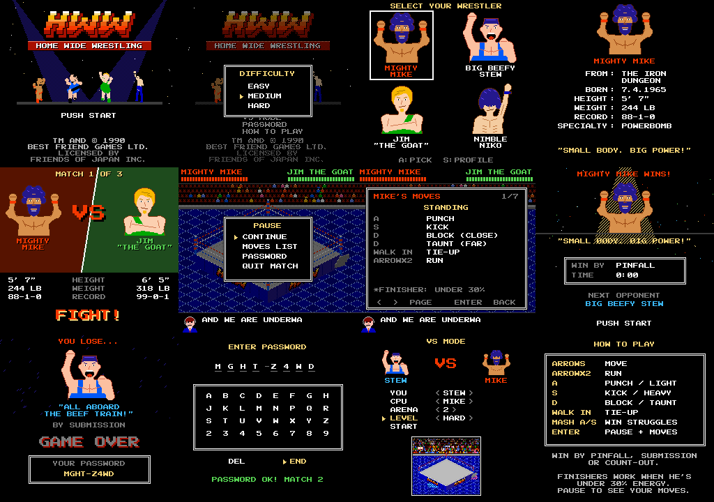

# Home Wide Wrestling

A small NES-style wrestling game starring real friends as made-up wrestlers: **Mighty Mike**, **Big Beefy Stew**, **Jim "The Goat"** and **Nimble Niko**. Win three matches, beat your nemesis in front of a packed house, and become the Home Wide Champion. Python + pygame, playable in the browser.

**▶ Play it in your browser: https://oo0speed0oo.github.io/home-wide-wrestling/** (keyboard; best on a computer)



## What's in it

- Four wrestlers, each with their own look, stats (speed, power, weight), two special moves and a finisher
- The full Tecmo-style move set: strikes, tie-ups on a tug-of-war meter, slams, running attacks, rope whips, pins, submissions, the top rope, fighting on the floor and the count-out
- An angled ring, three arenas that get bigger as you climb (the crowd's signs follow the match), entrances down the ramp, and an announcer who calls the action
- A CPU with three difficulty levels and a habit per wrestler you can learn and beat
- A 3-match run with your nemesis last (and a crooked ref), passwords, a Hall of Fame, the champion ending and credits, and VS mode
- NES-style chiptune music and sound, all made in code

## Play it on your computer

You need Python 3 (free, from [python.org](https://www.python.org/downloads/)). The launchers install pygame by themselves the first time.

| System | Do this |
|---|---|
| Windows | double-click `Home Wide Wrestling - Windows.bat` (tick "Add python.exe to PATH" when you install Python) |
| Mac | double-click `Home Wide Wrestling - Mac.command` (the first time: right-click it, Open) |
| Linux | run `./"Home Wide Wrestling - Linux.sh"` in a terminal |
| Any | `python game/main.py` |

## Controls

| Key | |
|---|---|
| Arrows | walk (double-tap to run), move around the menus |
| A | punch, the "light" button everywhere |
| S | kick, the "heavy" button everywhere |
| D | block when he's close, taunt when he's far, stop running |
| Enter | start / pause (moves list, password, quit match) |
| M | sound on/off |

Walk into him to lock up, then hold a direction and mash A or S: the button picks your move. When he's down: A pins, Up/Down+A stomps, Left/Right+A Boston crab, S drops on him. Finishers work once he's under 30% energy. Pause during a match to see your own moves list.

## How it's made

| Folder | What's there |
|---|---|
| `DESIGN_DOC.md` | the full game design: every rule and decision, and a note for each build step |
| `game/` | the game (`main.py`, the `hww/` package) and the assets it builds from the art |
| `game/tools/` | build tools: arena layers, screens, big heads, the balance simulation, the Windows `.exe`, the release and the web version |
| `export/` | the art and sound: sprite sheets, arenas, sound, preview reels, and the Python that draws it all (`export/source/`) |

Builds (made on Windows):

```
python game/tools/make_release.py "Version N"    # Windows .exe + Mac/Linux launchers + the website upload
python game/tools/build_web.py "Version N"       # the browser version only (pygbag)
python game/tools/balance_sim.py 16 2            # CPU vs CPU, every matchup
```
